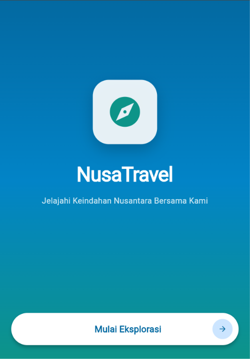
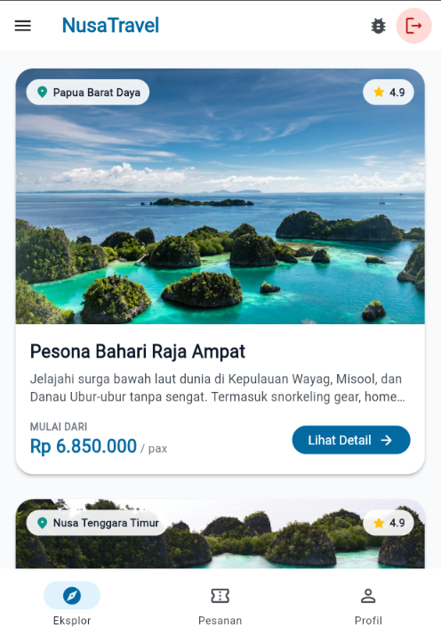
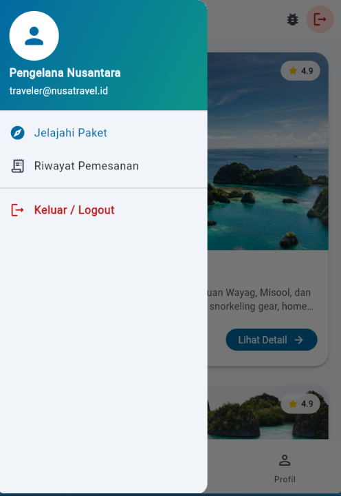
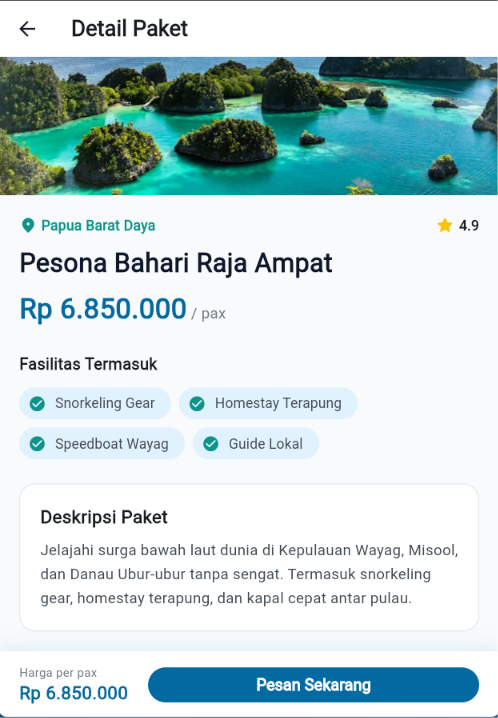
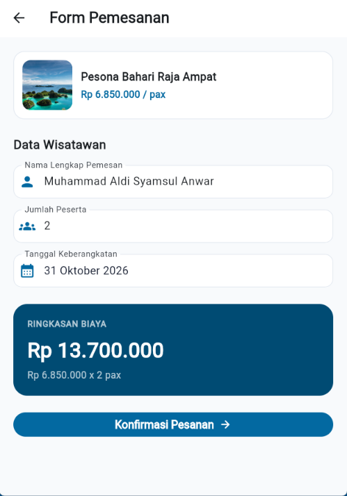
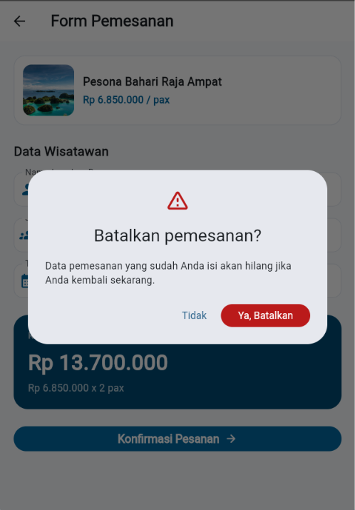
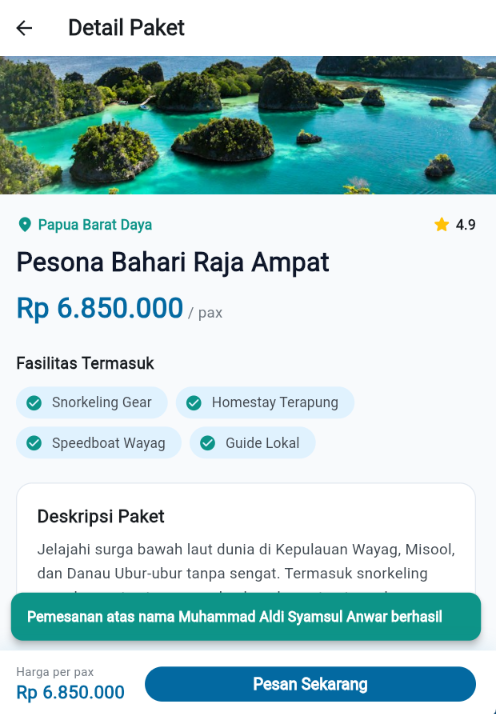
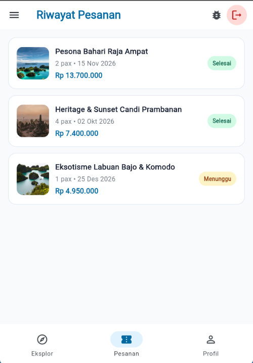
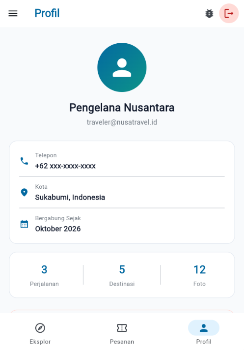
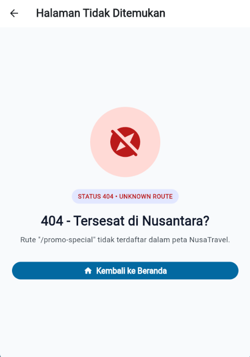

# 🌴 NusaTravel

Aplikasi eksplorasi dan reservasi paket wisata Nusantara yang dibangun dengan **Flutter**, menerapkan **Navigation & Routing** secara lengkap.

---

## 📋 Fitur Utama

| Fitur | Keterangan |
|---|---|
| **Splash Screen** | Logo + tombol "Mulai Eksplorasi", menggunakan `pushReplacementNamed()` |
| **Home Screen** | Daftar 4 paket wisata dengan Card/ListView, Drawer, NavigationBar, dan tombol Logout |
| **Detail Screen** | Informasi paket wisata via `pushNamed()` + `arguments` |
| **Booking Screen** | Form nama, jumlah peserta, tanggal keberangkatan (`Navigator.push()` & `Navigator.pop()`) |
| **Not Found Screen** | Halaman Error 404 via `onUnknownRoute` |
| **Riwayat Pesanan** | Menampilkan daftar riwayat pemesanan |
| **Profil** | Halaman profil sederhana dengan info pengguna |
| **PopScope** | Dialog konfirmasi saat menekan Back di Booking Screen |
| **SnackBar** | Notifikasi setelah pemesanan berhasil di Detail Screen |
| **Logout** | `pushNamedAndRemoveUntil()` untuk menghapus seluruh riwayat halaman |

---

## 🗂️ Struktur Folder

```
lib/
├── models/
│   └── tour_package.dart
├── routes/
│   └── app_routes.dart
├── screens/
│   ├── splash_screen.dart
│   ├── home_screen.dart
│   ├── detail_screen.dart
│   ├── booking_screen.dart
│   ├── history_screen.dart
│   ├── profile_screen.dart
│   └── not_found_screen.dart
└── main.dart
```

---

## 🧭 Konfigurasi Navigasi

Navigasi dikonfigurasi pada `MaterialApp` di `main.dart`:

```dart
MaterialApp(
  initialRoute: AppRoutes.splash,
  routes: AppRoutes.routes,
  onGenerateRoute: AppRoutes.onGenerateRoute,
  onUnknownRoute: AppRoutes.onUnknownRoute,
);
```

| Parameter | Kegunaan |
|---|---|
| `initialRoute` | Halaman pertama yang dibuka (Splash Screen) |
| `routes` | Route statis tanpa data (Splash, Home) |
| `onGenerateRoute` | Route yang membutuhkan arguments (Detail Screen) |
| `onUnknownRoute` | Fallback untuk route tidak dikenal (Not Found 404) |

---

## 📸 Screenshot Halaman

### 1. Splash Screen
Menampilkan logo NusaTravel dan tombol **"Mulai Eksplorasi"**.



### 2. Home Screen
Menampilkan daftar paket wisata menggunakan `ListView` + `Card`, dilengkapi **Drawer** dan **NavigationBar**.



### 3. Drawer
Menu navigasi samping dengan profil pengguna dan opsi Logout.



### 4. Detail Screen
Menampilkan informasi lengkap paket wisata yang dipilih.



### 5. Booking Screen
Form pemesanan dengan input nama, jumlah peserta, dan tanggal keberangkatan.



### 6. Dialog PopScope (Konfirmasi Batal)
Dialog muncul saat pengguna menekan tombol **Back** di Booking Screen, meminta konfirmasi pembatalan.



### 7. SnackBar Setelah Pemesanan Berhasil
SnackBar tampil di Detail Screen setelah pemesanan berhasil menggunakan `await Navigator.push()`.



### 8. Riwayat Pesanan
Menampilkan daftar riwayat pemesanan dengan status.



### 9. Profil
Halaman profil sederhana dengan info pengguna dan statistik.



### 10. Not Found Screen (404)
Halaman error ketika route tidak ditemukan, ditampilkan via `onUnknownRoute`.



---

## 🛠️ Model Data

```dart
class TourPackage {
  final String id;
  final String title;
  final String description;
  final int price;
  final String imageUrl;
  final String location;
  final double rating;
  final List<String> facilities;
}
```

---

## 🚀 Cara Menjalankan

```bash
# Clone repository
git clone <URL_REPOSITORY>
cd nusa_travel

# Install dependencies
flutter pub get

# Jalankan aplikasi
flutter run
```

---

## 📦 Dependencies

- Flutter SDK
- Material Design 3 (bawaan Flutter)

---

## 👤 Dibuat Oleh

**NusaTravel** — Jelajahi Keindahan Nusantara Bersama Kami 🇮🇩
